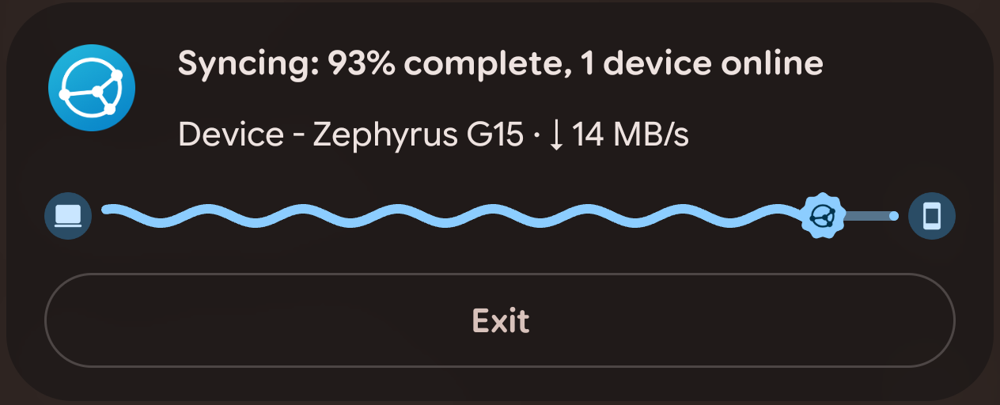
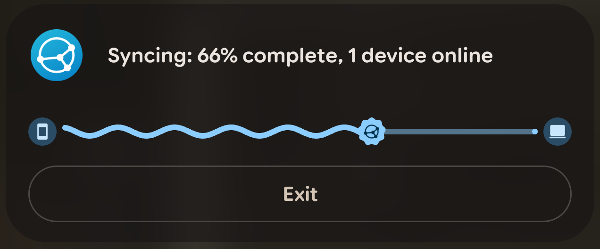

<div align="center">


# Syncthing Live Update

**Syncthing's sync progress as an Android Live Update — in the status bar chip, on the lock screen and on Always-on Display.**

No second notification. No REST polling. No API key.


> [!IMPORTANT]
> **Android 17 QPR2 (November update):** v1.1.1 crash-loops SystemUI on this release.
> **Update to v1.1.2**, which fixes it. If SystemUI is already crashing, uninstall the module
> over adb first, then install v1.1.2.


<br>

[](https://github.com/MrxSiN/syncthing-liveupdate/releases)
[](https://github.com/MrxSiN/syncthing-liveupdate/releases)
[-3DDC84?logo=android&logoColor=fff&style=for-the-badge)](https://developer.android.com/about/versions/16)
[](https://github.com/researchxxl/syncthing-android)
[](https://github.com/libxposed/api)

</div>

---

> [!NOTE]
> **Compatible with the latest Syncthing-Fork.** Every class, method and field this module
> hooks is verified present in **2.1.5.0** (latest stable) and **2.1.6.0-rc.1** (latest
> pre-release) from [researchxxl/syncthing-android](https://github.com/researchxxl/syncthing-android),
> by `checks/host-contract.checks`, which CI re-runs weekly. 2.1.5.0 and the R8-shrunk
> 2.1.7.0 (F-Droid mirrors) are also confirmed on a physical device, where renamed members are
> found by what they do.

## Why it works this way

Android 16 introduced Live Updates: promoted ongoing notifications that surface in the status
bar chip, on the lock screen and on Always-on Display. Syncthing already knows how far along a
sync is — it simply has no way to say so in that format. This module supplies the missing part
and nothing else.

|  | |
|---|---|
| 🔁 **One notification, not two** | The notification Syncthing already posts is rewritten on its way to the system. Its title, icon, Exit action and tap target are kept, and it stays the foreground-service notification the app depends on. |
| 🔌 **No polling** | Every figure, including the transfer rate and time left, is read from the host's own callbacks at the moment the host recalculates it. No REST calls, no API key, no timers, no background service, and no notification update of its own. |
| 🧩 **Contained** | Every hook is protective and installs through one boundary. A hook that cannot install costs its own feature and nothing else — Syncthing is left exactly as it was. |
| 🎯 **Only this app** | `FLAG_PROMOTED_ONGOING` is restored for this module's own channel in Syncthing-Fork alone. Every other notification on the device keeps the platform's verdict. |
| 🔍 **Found by shape, not just by name** | The hooked host methods are located with [DexKit](https://github.com/LuckyPray/DexKit) before falling back to a name lookup, so an upstream rename does not silently disable a feature. |
| 😴 **Idle is untouched** | When nothing is transferring the notification is passed straight through, so the idle behaviour is the one Syncthing ships with. |

---

## Features

<details open>
<summary><b>📊 The Live Update</b></summary>
<br>

While a transfer runs, Syncthing's own persistent notification becomes a promoted Live Update
with a `Notification.ProgressStyle` bar for overall sync completion, and a percentage in the
status bar chip through `setShortCriticalText`.

| Element | What it shows |
|---|---|
| **Progress bar** | Overall completion, reported in tenths of a percent so movement is smooth rather than stepped |
| **Start and end icons** | Tonal circles holding the Material Symbols `smartphone` and `computer` glyphs, in the order the data moves |
| **Tracker** | The nine-sided "cookie" from the Material 3 Expressive shape set, filled with Syncthing's primary colour and carrying the host's own glyph |
| **Second line** | The folders currently transferring, by their configured labels (past two, the remainder becomes a count), then `↓`/`↑` transfer rates and `≈` time left when Syncthing's figures support them |
| **Lock screen** | With sensitive content hidden, "Syncing files" with the percentage, rate and estimate instead of folder names |
| **Status icon badge** | Down while this device pulls, up while a remote pulls from it, both arrows when each happens at once |
| **Chip text** | The completion percentage |

<table>
<tr>
<td align="center" colspan="2"><br><sub>A download with its folder and rate, over the wavy bar (v1.2.0); the time left joins the line once three samples agree</sub></td>
</tr>
<tr>
<td align="center"><br><sub>The notification during an upload: host title and Exit action untouched</sub></td>
<td align="center"><br><sub>The same notification as a status bar chip</sub></td>
</tr>
</table>

**Rate and time left.** `↓` and `↑` rates come from how fast the bytes Syncthing still needs
fall: folder summaries for this device's downloads, remote completion for uploads. They are
sampled at most every 2 s and smoothed, and shown in the system's own units (`Formatter`). A rate
needs two samples and at least 1 kB/s; the estimate (`≈ 3 min`, through ICU's `MeasureFormat`)
needs three samples in every direction that still has work, and disappears past a day. Nothing is
shown during a scan, and nothing is estimated from figures Syncthing did not report.

**Lock screen.** When Android is set to hide sensitive notification content, the lock screen
shows "Syncing files" with the percentage, rate and estimate instead of folder names. With
sensitive content shown, the full Live Update appears as usual. Android's own lock-screen
settings decide which one, and whether a silent notification is shown there at all.

Colours are Material 3 roles derived from Syncthing's blue `#0891D1` with the fidelity scheme,
resolved for the light or dark theme. SystemUI draws the progress icons untinted, so each
shape and its glyph are rendered into a bitmap once per theme.

</details>

<details open>
<summary><b>🌊 SystemUI polish</b></summary>
<br>

`ProgressStyle` cannot express everything, so the rest is added where SystemUI draws it. Each
hook first checks it is looking at Syncthing-Fork's notification; every other app's bar and
chip are drawn by the platform exactly as before.

| Polish | What changes |
|---|---|
| **Wavy progress** | The filled part of the bar becomes a Material 3 Expressive wave — 4dp stroke, 3dp amplitude, 40dp wavelength — flowing one wavelength per second and flattening near either end, followed by a flat track and a stop dot |
| **Spring motion** | Each update is applied at the value on screen, and the bar then travels to the new value on a critically damped spring, so it never overshoots and never teleports |
| **Chip colour** | The chip is filled with Syncthing's primary colour and its content drawn in on-primary, instead of the system surface grey Android 17 would otherwise use |

This whole section is optional. Without the SystemUI scope the Live Update still works; the
bar is simply the flat one the platform draws.

It is also self-limiting. The wave asks for a new frame at most every 16ms, so a 120Hz panel
does not double the work, and three failed draws switch the custom drawing off for the rest of
the process rather than retrying on every frame.

</details>

<details open>
<summary><b>🛡 Failing open</b></summary>
<br>

A module that patches private code will eventually meet a build it does not fit, and the only
acceptable outcome is that a feature disappears rather than the host breaking.

| Boundary | What it guarantees |
|---|---|
| `hook` | The single path to the framework. A failed installation is caught and logged, and returns false, so every feature inherits the same policy |
| `find_class_diag`, `find_method`, `read_field` | Return null for anything they cannot reach, after recording why |
| `polish_supported` and the other contract functions | An Android release the module has not been read against keeps the base Live Update and deliberately leaves the SystemUI polish off, rather than guessing at private names |
| `wave_give_up` | Gives up on the custom drawing after three failed draws and lets the platform draw the bar |
| `-catch` JVM calls | A call that can throw inside a hook catches it, and the hook falls back to the host's own arguments or result |

Reflection failures are reported once each, classified and with the context to act on:

```text
Reflection ABSENT: …ColorsModel$Custom expected=any constructor,
  sdk=37, fingerprint=google/husky/husky:17/CP3A.260905.009/…, cause=none
```

`ABSENT` is an upstream rename, `DENIED` a tightened hidden-API policy, `THREW` a member that
still exists but no longer behaves as assumed.

</details>

<details>
<summary><b>🧪 Keeping up with Syncthing-Fork</b></summary>
<br>

The update most likely to break this module is an upstream release that renames or removes
something it hooks. Compiling cannot notice that, because the host is not on the module's
classpath.

```sh
HOST_VERSION=2.1.6.0 HOST_TAG=v2.1.6.0-rc.1
curl -fsSL -o build/host.apk "https://github.com/researchxxl/syncthing-android/releases/download/$HOST_TAG/com.github.catfriend1.syncthingfork_release_v$HOST_VERSION.apk"
unzip -p build/host.apk 'classes*.dex' > build/host.dex
build/xcheck checks/host-contract.checks
```

`xcheck` (the project's XAX checker, [docs/build.md](docs/build.md#checks)) looks for every
hooked class, method and field of `checks/host-contract.checks` in that release's dex string pools. CI runs it weekly and on demand — so an upstream release shows up as a
failing scheduled run rather than as a surprise on someone's phone.

</details>

---

## Status

**v1.2.0, written in XAX.** Compatible with **Android 16+ (API 36)** and **Syncthing-Fork 2.1.5.0 – 2.1.7.0**, including R8-shrunk builds. arm64 devices only.

| Component | Evidence |
|---|---|
| **1.2.0 (XAX)** | Pixel 8 Pro, `CP4A.261105.040.A1`, Syncthing-Fork 2.1.7.0, 2026-11-23: real 0.5–2 GB uploads and downloads promoted with rate and time left (`↓ 25 MB/s · ≈ 32 sec`), hooks installed from the resolution cache, no crash. See [compatibility](docs/compatibility.md) |
| **Android 17 (SDK 37)** | Pixel 8 Pro, builds `CP2A.260805.005` and `CP3A.260905.009`, Vector 2.2. Full path confirmed on device |
| **Android 17 QPR2** | Build `CP4A.261105.040.A1`: 1.1.2 confirmed on device: no crash, every hook resolved, a real download promoted |
| **Android 16 (SDK 36)** | **Not tested on a device.** Its promotion path is written from the documented rule and not yet run |
| **Syncthing-Fork 2.1.5.0** | Contract verified, and exercised on a device |
| **Syncthing-Fork 2.1.6.0-rc.1** | Contract verified |

Known limits:

- Android 16 asks for promotion through `setColorized` and Android 17 through
  `setRequestPromotedOngoing`; only the Android 17 path has run on hardware.
- The SystemUI polish reads private SystemUI internals. It switches itself off, with a reason
  in the log, on a release the module has not been read against.

## Requirements

| | |
|---|---|
| **Android** | 16 or newer (API 36). Live Updates do not exist before that |
| **Host** | [Syncthing-Fork](https://github.com/researchxxl/syncthing-android) (`com.github.catfriend1.syncthingfork`) |
| **Framework** | [Vector](https://github.com/JingMatrix/Vector) v2.2+ (libxposed API 102) with Magisk or KernelSU and Zygisk. LSPatch cannot run this module — the promotion flag has to be restored inside `system_server`, which a rootless patch cannot reach |
| **Root** | Required by the framework; the module itself asks for none |

Built against the modern [libxposed API](https://github.com/libxposed/api)
(`io.github.libxposed:api`), not the legacy `de.robv.android.xposed` bridge.

## Install

```
1. Install the APK from Releases
2. Enable Syncthing Live Update in Vector
3. Grant the scope: system server, Syncthing-Fork and SystemUI
4. Reboot once
5. Watch logcat for the tag SyncthingLiveUpdate
```

The module declares a **static scope**, but the system server entry generally has to be
confirmed by hand. With the Vector CLI, steps 2 and 3 are:

```sh
su -c '/data/adb/lspd/cli modules enable io.github.mrxsin.syncthingliveupdate'
su -c '/data/adb/lspd/cli scope set io.github.mrxsin.syncthingliveupdate system/0 com.github.catfriend1.syncthingfork/0 com.android.systemui/0'
```

After installing an update, restart the framework so `system_server` loads it:

```sh
su -c 'stop; start'
```

The module declares `autoHotReload`, so Syncthing and SystemUI load an update without this.
`system_server`, which holds the promotion patch, loads it only at a framework start. Until then
the module says so in the log rather than leaving the Live Update silently unpromoted.

A healthy start logs the framework, the platform contract, the host method being observed and
the channel it will promote on:

```text
Syncthing Live Update v1.2.0 loaded in com.github.catfriend1.syncthingfork,
  framework=Vector 2.2, api=102, contract=Android 17 (API 37), …
DexKit indexed 1 dex file(s) in 21ms
Observing public final void sn1.g(…SyncthingService, java.lang.Boolean, int, int)
Promoting the host notification on channel 05_syncthing_live_update
```

`DexKit indexed …` appears on the first start after Syncthing is installed or updated. Later starts
answer from the resolution cache and skip it.

## Build

The module is written in [XAX](https://github.com/MrxSiN/XAX). Its canonical source is the store
`source/xax/syncthingliveupdate.xax`; `toolchains.json` pins the compiler. With a checkout of XAX
at that commit:

```sh
xaxc=path/to/XAX/compiler/bootstrap/seed/xaxc-linux-x86_64   # or windows/xaxc-windows-x86_64.exe
"$xaxc" verify  source/xax/syncthingliveupdate.xax verify.rec
"$xaxc" resolve source/xax/syncthingliveupdate.xax snapshot.xax source/inputs/*
"$xaxc" build   snapshot.xax SyncthingLiveUpdate-unsigned.apk provenance source/inputs/*
apksigner sign --ks release.jks --out SyncthingLiveUpdate.apk SyncthingLiveUpdate-unsigned.apk
```

Both seeds build the same APK bytes. Release signing stays outside the build: CI signs with
`apksigner` from repository secrets, and nothing is stored here. How the store is edited, and
what `source/inputs/` holds, is in [docs/build.md](docs/build.md).

`checks/project.checks` holds the project's structural checks; CI runs them first with `xcheck`,
the project's own XAX checker. Running them locally is in [docs/build.md](docs/build.md#checks).

---

## How it works

```
Syncthing-Fork ──NotificationHandler.updatePersistentNotification──▶ hk_progress ─▶ meter_update (host.json)
               ──LocalCompletion.setFolderStatus──▶ hk_folder_status: folders, bytes still needed
               ──RemoteCompletion.setCompletionInfo──▶ hk_remote_completion: bytes remotes still need
                                                                     │
                                       Service.startForeground ◀─────┴─▶ hk_start_foreground ─▶ appearance_apply (promoter.json)
                                                │
system_server ──NotificationManagerService.fixNotificationWithChannel──▶ promote: FLAG_PROMOTED_ONGOING (module.json)
                                                │
SystemUI ──NotificationProgressDrawable.draw───▶ hk_wavy_draw ─▶ wave_draw (06-wave.batch)
         ──NotificationProgressBar.setProgressModel──▶ hk_progress_model (systemui.json)
         ──OngoingActivityChipModel$Active──▶ hk_chip (systemui.json)
```

Full detail, per process, is in [docs/architecture.md](docs/architecture.md).

| Page | What is in it |
|---|---|
| [docs/architecture.md](docs/architecture.md) | What is hooked in each process, and why it is hooked there |
| [docs/compatibility.md](docs/compatibility.md) | Which Android and Syncthing-Fork releases are supported, and which have actually been tested |
| [docs/troubleshooting.md](docs/troubleshooting.md) | What each log line means, and what to do about it |
| [docs/build.md](docs/build.md) | How the XAX store is built, edited and checked |

<details>
<summary><b>Why the channel changes during a transfer</b></summary>
<br>

The host posts its persistent notification on an `IMPORTANCE_MIN` channel, and the platform
refuses to promote anything posted there. During a transfer the notification is moved to
`05_syncthing_live_update` at `IMPORTANCE_LOW`; when the sync completes it goes back to
`01_syncthing_persistent` and behaves exactly as before.

</details>

<details>
<summary><b>Why a flag has to be restored in system_server</b></summary>
<br>

Android sets `FLAG_PROMOTED_ONGOING` only for a package holding
`android.permission.POST_PROMOTED_NOTIFICATIONS`. Syncthing-Fork does not declare it, and an
install-time permission cannot be granted after the fact — `pm grant` will not do it. So the
module restores that single flag, and only when the package is Syncthing-Fork **and** the
channel is the module's own. Nothing else about the platform's promotion policy is touched.

</details>

<details>
<summary><b>What it costs</b></summary>
<br>

Measured on a Pixel 8 Pro (Android 17 QPR2, Syncthing-Fork 2.1.7.0) with temporary timing builds:

| Path | Cost |
|---|---|
| Hook installation at Syncthing start | 4–5 ms from the resolution cache; 60–140 ms on the first start after a Syncthing install or update, when DexKit indexes the APK |
| Rewriting the notification on each host update | 3.7 ms median (11.8 ms p90), about once a second while a sync runs |
| Folder-status hook, per host event | 12 µs median |
| Wave on Syncthing's bar, per frame while the shade is open | 142 µs median, 74 frames/s, about 1.5% of one core; SystemUI kept 0 missed vsyncs |

Nothing runs while Syncthing is idle, and the module posts no notification updates of its own.

</details>

---

## Credits

| Project | Contribution |
|---|---|
| [Syncthing-Fork](https://github.com/researchxxl/syncthing-android) | The host application whose sync figures and notification this module builds on. MPL-2.0 |
| [Vector](https://github.com/JingMatrix/Vector) by JingMatrix | The ART hooking framework used in the app process, the system server and SystemUI. GPL-3.0 |
| [libxposed API](https://github.com/libxposed/api) | The modern Xposed module API this module compiles against. Apache-2.0 |
| [DexKit](https://github.com/LuckyPray/DexKit) by LuckyPray | Finds the hooked host methods by shape, so an upstream rename does not silently disable a feature. Apache-2.0 |
| [Material Symbols](https://github.com/google/material-design-icons) | The `smartphone` and `computer` glyphs at either end of the progress bar. Apache-2.0 |

## Disclaimer

This project is not affiliated with, endorsed by, or sponsored by the Syncthing project or the
maintainers of Syncthing-Fork. It is provided for educational and personal use. Host app
updates or Android platform changes may break the hooks without notice.
