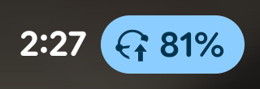

# Syncthing Live Update

**Syncthing's sync progress as an Android Live Update, in the status bar chip, on the lock screen and on Always-on Display.**

No second notification. No REST polling. No API key.

[-3DDC84?logo=android&logoColor=fff&style=for-the-badge)](#install)

## Features

- **A Live Update from the notification Syncthing already posts.** Its title, icon, Exit action and tap target stay; idle notifications pass through untouched.
- **Progress** as a `ProgressStyle` bar and a percentage in the status bar chip.
- **Rate and time left:** `↓ 25 MB/s · ≈ 32 sec`, from the bytes Syncthing reports as still needed. Shown only once it is reliable, never during a scan.
- **Folders** being synced, by their labels, and a direction badge on the status icon.
- **Lock screen:** with sensitive content hidden, "Syncing files" with the percentage, rate and estimate instead of folder names.
- **SystemUI polish** (optional scope): a Material 3 Expressive wavy bar, a spring between values, and the chip in Syncthing's blue.

Every figure comes from Syncthing's own callbacks: no REST calls, timers or background service, and no notification updates of its own.

## Install

1. Get the APK from [Releases](https://github.com/MrxSiN/syncthing-liveupdate/releases).
2. Enable it in [Vector](https://github.com/JingMatrix/Vector) (libxposed API 102) with the scope **System Framework**, **Syncthing-Fork** and, for the polish, **System UI**.
3. Reboot once, so `system_server` loads it.

Needs Android 16 or newer on arm64, root for the framework, and [Syncthing-Fork](https://github.com/researchxxl/syncthing-android).
LSPatch cannot run it: the promotion flag has to be restored inside `system_server`.

Updates reach Syncthing and SystemUI on their next start; `system_server` takes them after
`su -c 'stop; start'` or a reboot, and the log says so until then.

## Compatibility

| | Status |
|---|---|
| Android 17 (incl. QPR2) | Tested on a Pixel 8 Pro: uploads and downloads promoted with rate and estimate, no crash |
| Android 16 | Written from the documented rule; **not tested on a device** |
| Syncthing-Fork 2.1.5.0 – 2.1.7.0 | Tested, including the R8-shrunk 2.1.7.0; 2.1.6.0-rc.1 contract-checked |

Hooked members are found with [DexKit](https://github.com/LuckyPray/DexKit) by what they do, so renamed and shrunk
builds still resolve; the result is cached per Syncthing install, so later starts take 4–5 ms. CI checks the
supported release every week. Details: [compatibility](docs/compatibility.md).

## Troubleshooting

Everything is logged under the tag `SyncthingLiveUpdate`.

| Problem | Try |
|---|---|
| Bar but no chip, never promoted | Grant the System Framework scope and reboot. |
| Flat bar, grey chip | Grant the System UI scope. |
| Not on the lock screen | Android's lock-screen settings decide; Syncthing's notification is silent. |
| Nothing at all during a sync | Look for `Host notification method not found`: a Syncthing update moved it. |

More in [troubleshooting](docs/troubleshooting.md).

## How it works

The module is written in [XAX](https://github.com/MrxSiN/XAX); there is no Java, Kotlin or Gradle. In Syncthing it
observes the method the host publishes its sync figures through and rewrites the notification on its way to
`startForeground`. In `system_server` it restores `FLAG_PROMOTED_ONGOING` for its own channel only, which
Syncthing cannot request itself. In SystemUI it redraws Syncthing's bar and chip. Every hook fails open: one that
cannot install costs its own feature and leaves Syncthing as it was.

[Architecture](docs/architecture.md) · [build](docs/build.md) · [compatibility](docs/compatibility.md) · [changelog](CHANGELOG.md)

## Support

If the module is useful to you, you can [sponsor its development](https://github.com/sponsors/MrxSiN).

## Credits and license

[Syncthing-Fork](https://github.com/researchxxl/syncthing-android), [Vector](https://github.com/JingMatrix/Vector),
[libxposed](https://github.com/libxposed/api), [DexKit](https://github.com/LuckyPray/DexKit) and
[Material Symbols](https://github.com/google/material-design-icons).

GPL-3.0. Not affiliated with the Syncthing project or the maintainers of Syncthing-Fork.
